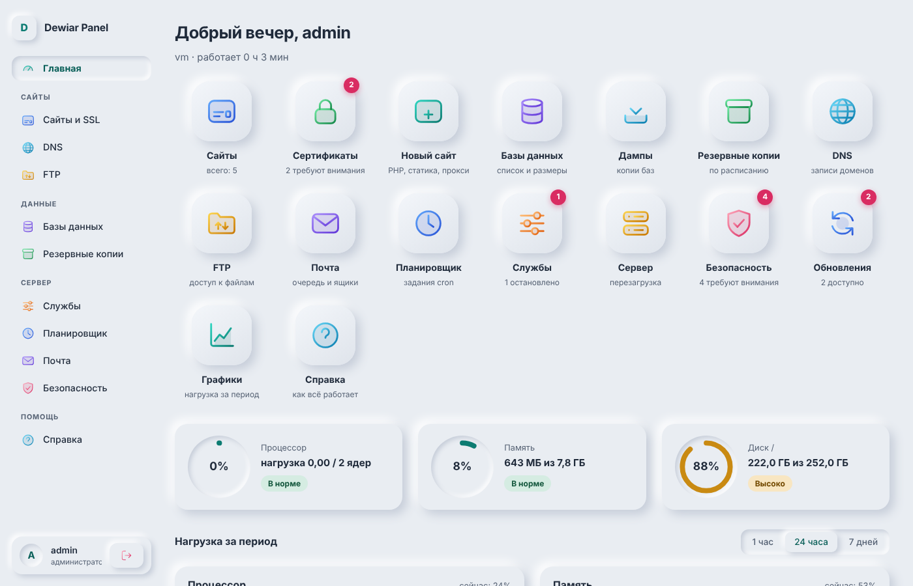
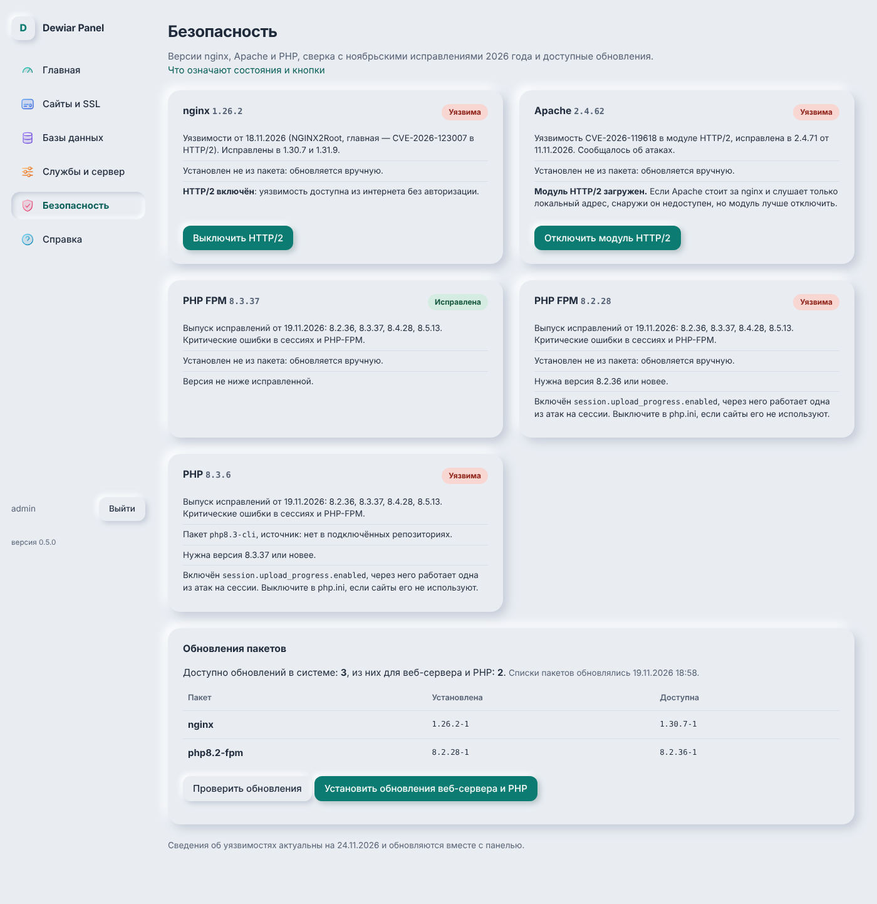

# Dewiar Server Panel

**Русский** · [English](#english)

Панель управления веб-сервером и альтернатива FASTPANEL для тех, кто остался без него.
Ставится на тот же сервер и сразу показывает уже настроенные сайты, домены и сертификаты.
Ничего переносить и настраивать заново не нужно.

> **Версия 0.6.0, ранняя.** Панель проверена на тестовом стенде и ещё не прошла проверку
> на рабочих серверах и независимый аудит безопасности. Она работает с правами администратора
> сервера, учитывайте это.

## Зачем она нужна

Серверы лицензий FASTPANEL перестали отвечать, и панель больше не пускает владельцев серверов.
Сайты при этом продолжают работать, но продлить сертификат, добавить сайт или поправить
настройки без панели неудобно. Dewiar Server Panel закрывает эти задачи и не зависит ни от
какого внешнего сервера лицензий: если наш сайт исчезнет, ваша панель продолжит работать.

## Что уже есть

| Раздел | Возможности |
|---|---|
| Сайты | Карточка на каждый сайт из действующей конфигурации nginx, включая созданные в FASTPANEL |
| SSL | Выпуск и автопродление Let's Encrypt, wildcard-сертификаты через TXT-записи в DNS |
| Новый сайт | PHP (отдельный пользователь и пул PHP-FPM), статический сайт, прокси на приложение |
| Конфигурация | Редактор файлов nginx и Apache с проверкой перед применением и автоматическим откатом |
| PHP | Смена версии одной кнопкой для сайтов, созданных в панели |
| Базы данных | Список баз MySQL и MariaDB, дампы, скачивание, восстановление из дампа |
| Резервные копии | Ежедневные копии файлов сайтов и баз по расписанию, срок хранения, скачивание |
| Планировщик | Задания cron: добавление и удаление, просмотр остальных заданий сервера |
| FTP | Аккаунты ProFTPD, привязанные к каталогу одного сайта |
| Почта | Состояние Exim или Postfix, очередь писем, список ящиков |
| DNS | Проверка записей доменов: адрес, серверы имён, MX, SPF, DMARC |
| Службы | Состояние, перезапуск, перечитывание конфигурации, перезагрузка сервера |
| Графики | Процессор, память, нагрузка и сеть за час, сутки и неделю |
| Безопасность | Сверка версий nginx, Apache и PHP с исправлениями уязвимостей, обновления, защитные меры |
| Справка | Встроенная в панель, с пояснениями на каждой странице |

## Чего пока нет

Создание и удаление почтовых ящиков, редактирование DNS-зон на сервере, выгрузка копий во внешнее
хранилище, файловый менеджер, файрвол. Почта и DNS пока доступны для просмотра и диагностики.
Эти службы на сервере продолжают работать как раньше. Недостающее в плане разработки.

## Как это устроено

- Веб-часть на PHP работает от отдельного пользователя без прав root.
- Все системные действия выполняет небольшой помощник с фиксированным списком команд.
- Существующие конфиги сайтов панель читает и не изменяет, пока вы сами не попросите.
- Перед заменой сертификата или файла настроек прежняя версия сохраняется.

## Требования

Linux с systemd, работающий nginx, PHP 7.4 или новее, доступ root по SSH.

## Установка

После получения разрешения на использование (см. «Лицензия»):

    bash /root/dewiar-panel/install.sh

Подробная инструкция по шагам: [Ustanovka.pdf](Ustanovka.pdf).

## Лицензия

Код открыт **только для просмотра**. Его можно читать, изучать и проверять на безопасность.
Установка, использование, копирование и изменение требуют письменного разрешения
правообладателя. Полный текст: [LICENSE](LICENSE).

Запросы на использование и сообщения об уязвимостях: через контакты на https://dewiar.pro.
Об уязвимостях, пожалуйста, сообщайте лично, до публикации.

## Автор

Исаев Михаил Петрович, Dewiar. Код написан при участии ИИ-ассистента Claude (Anthropic).

Dewiar Server Panel — самостоятельная разработка. Она не содержит кода FASTPANEL и не связана
с его разработчиками. FASTPANEL — товарный знак его правообладателя.

---

# Dewiar Server Panel (English)

A web server control panel and an alternative to FASTPANEL for people who have lost access to it.
Install it on the same server and it immediately shows the sites, domains and certificates that
are already configured. Nothing has to be migrated or set up again.

> **Version 0.6.0, early.** The panel has been tested on a test bench. It has not yet been
> proven on production servers and has had no independent security audit. It operates with
> server administrator privileges, so treat it accordingly.

## Why it exists

The FASTPANEL license servers stopped responding, and the panel no longer lets server owners in.
The sites keep running, but renewing a certificate, adding a site or changing settings without
a panel is inconvenient. Dewiar Server Panel covers these tasks and does not depend on any
external license server: if our website disappears, your panel keeps working.

## What it does today

| Area | Features |
|---|---|
| Sites | A card for every site in the live nginx configuration, including sites created in FASTPANEL |
| SSL | Let's Encrypt issue and auto-renewal, wildcard certificates through DNS TXT records |
| New site | PHP (own system user and PHP-FPM pool), static site, reverse proxy to an application |
| Configuration | Editor for nginx and Apache files with a syntax check before applying and automatic rollback |
| PHP | One-click version switch for sites created in the panel |
| Databases | MySQL and MariaDB database list, dumps, download, restore from a dump |
| Backups | Daily scheduled backups of site files and databases, retention, download |
| Scheduler | Cron jobs: add and delete, read-only view of the server's other jobs |
| FTP | ProFTPD accounts confined to a single site directory |
| Mail | Exim or Postfix status, mail queue, mailbox list |
| DNS | Domain record checks: address, name servers, MX, SPF, DMARC |
| Services | Status, restart, configuration reload, server reboot |
| Charts | CPU, memory, load and network for the last hour, day and week |
| Security | nginx, Apache and PHP versions checked against vulnerability fixes, updates, mitigations |
| Help | Built into the panel, with an explanation on every page |

The interface is currently in Russian.

## Not there yet

Creating and deleting mailboxes, editing DNS zones on the server, uploading backups to external
storage, file manager, firewall. Mail and DNS are currently view-and-diagnose only.
These services keep running on the server as before. The missing parts are on the roadmap.

## How it works

- The PHP web part runs as a separate user without root privileges.
- All system actions go through a small helper with a fixed list of commands.
- Existing site configs are read and never changed unless you ask for it.
- Before a certificate or a config file is replaced, the previous version is saved.

## Requirements

Linux with systemd, a running nginx, PHP 7.4 or newer, root access over SSH.

## Installation

After you have received permission to use the panel (see "License"):

    bash /root/dewiar-panel/install.sh

Step-by-step guide (in Russian): [Ustanovka.pdf](Ustanovka.pdf).

## License

The code is **source-available for viewing only**. You may read it, study it and review its
security. Installing, using, copying or modifying it requires written permission from the
copyright holder. Full text: [LICENSE](LICENSE).

Usage requests and vulnerability reports: through the contacts at https://dewiar.pro.
Please report vulnerabilities privately before publishing them.

## Author

Mikhail Petrovich Isaev, Dewiar. The code was written with the help of the Claude AI assistant (Anthropic).

Dewiar Server Panel is an independent project. It contains no FASTPANEL code and is not
affiliated with its developers. FASTPANEL is a trademark of its owner.
